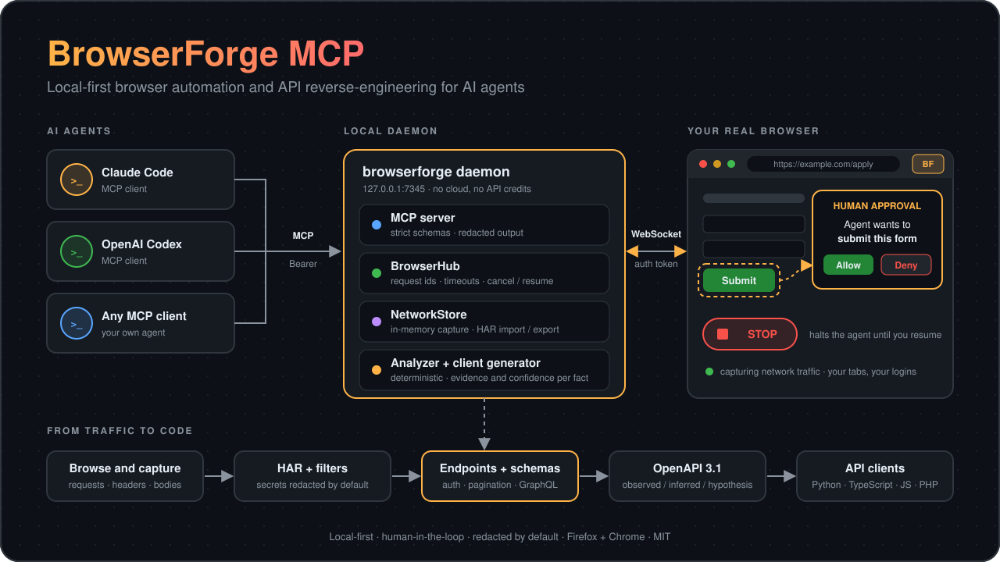

<div align="center">



# BrowserForge MCP

**Give your AI agent a real browser, and turn the traffic it sees into API docs and clients.**

A local-first Firefox + Chrome extension and MCP server for Claude Code, OpenAI Codex and any other MCP client.


</div>

---

## Why BrowserForge

| | |
|---|---|
| **Real browser, real session** | A WebExtension, not a headless clone: your tabs, your logins, your cookies. |
| **Local-first** | Everything runs on `127.0.0.1`. No cloud service, no API credits. |
| **Reverse-engineer APIs** | Capture traffic, then get endpoints, schemas, auth and pagination, an OpenAPI 3.1 spec and Python / TypeScript / JavaScript / PHP clients. |
| **Human in the loop** | Submitting forms, purchases, sending, accepting terms, passwords and uploads wait for a click in the extension popup that the agent cannot answer. A red **STOP** halts the agent until you resume. |
| **Honest output** | Every inferred API fact is labelled `observed`, `inferred` or `hypothesis` with confidence and evidence. Per-browser capture limits are documented in [docs/LIMITATIONS.md](docs/LIMITATIONS.md). |
| **Secure by default** | Token-authenticated loopback transports, Origin/Host checks, strict schemas, secret redaction, path-safe file access. See [docs/SECURITY.md](docs/SECURITY.md). |

## Quick start

Requires Node.js 20 or newer, and Firefox or Chrome.

```bash
npm install && npm run build
node apps/mcp-server/dist/cli.js serve     # prints endpoints, creates tokens in ~/.config/browserforge/
node apps/mcp-server/dist/cli.js tokens    # shows the extension token
```

1. **Load the extension.**
   - Firefox: `about:debugging#/runtime/this-firefox` → *Load Temporary Add-on* → `apps/firefox-extension/dist/firefox/manifest.json`
   - Chrome: `chrome://extensions` → Developer mode → *Load unpacked* → `apps/firefox-extension/dist/chrome`
2. **Connect it.** Click the toolbar icon, paste the **extension token**, press *Connect*.
3. **Connect your agent.** Guides: [Codex](docs/CODEX.md) · [Claude Code](docs/CLAUDE_CODE.md)
   ```bash
   codex mcp add browserforge --url http://127.0.0.1:7345/mcp --bearer-token-env-var BROWSERFORGE_MCP_TOKEN
   claude mcp add --transport http browserforge http://127.0.0.1:7345/mcp --header "Authorization: Bearer $(cat ~/.config/browserforge/mcp-token)"
   ```
4. **Try it.** Start the demo site with `node tests/fixtures/demo-site/server.mjs`, then ask your agent:

   > Call `system_status`, then open `http://127.0.0.1:8099/apply` and describe the form.

Full instructions: [docs/INSTALL.md](docs/INSTALL.md). Problems: [docs/TROUBLESHOOTING.md](docs/TROUBLESHOOTING.md).

## Things you can ask your agent

- *"Open this site, click through the checkout flow, and tell me which API calls it makes."*
- *"Analyze the captured traffic and generate an OpenAPI spec and a Python client for the endpoints I used."*
- *"Fill in the application form from my saved profile, show me a preview, and wait for my approval before submitting."*
- *"Export the capture as a HAR file with secrets redacted."*

More end-to-end examples: [docs/WORKFLOWS.md](docs/WORKFLOWS.md).

## Tools

| Namespace | Tools |
|---|---|
| **browser** | `browser_get_tabs`, `browser_get_active_tab`, `browser_select_tab`, `browser_navigate`, `browser_click`, `browser_type`, `browser_fill_field`, `browser_select_option`, `browser_scroll`, `browser_press_key`, `browser_get_page_text`, `browser_get_dom_snapshot`, `browser_get_interactive_elements`, `browser_take_screenshot`, `browser_wait_for_element`, `browser_get_forms`, `browser_fill_form`, `browser_get_downloads`, `browser_get_console_errors`, `browser_pause`, `browser_resume`, `browser_stop` |
| **network** | `network_list_requests`, `network_get_request`, `network_get_request_details`, `network_search_requests`, `network_list_captures`, `network_configure_capture`, `network_export_har`, `network_import_har`, `network_clear_capture` |
| **api** (reverse engineering) | `api_analyze_traffic`, `api_list_endpoints`, `api_get_endpoint_details`, `api_generate_openapi`, `api_generate_client` |
| **form** | `form_profile_save`, `form_profile_list`, `form_profile_delete`, `form_discover`, `form_fill_from_profile`, `form_validate`, `form_preview_submission`, `form_prepare_cover_letter` |
| **goal** (optional, local model) | `browser_run_goal`, `browser_goal_feedback` |
| **knowledge** | `knowledge_add_document`, `knowledge_search`, `knowledge_list`, `knowledge_remove`, `knowledge_export_dataset` |
| **workflow** | `workflow_create`, `workflow_run`, `workflow_pause`, `workflow_resume`, `workflow_get_status` |
| **system** | `system_status`, `system_diagnostics` |

Read-only tools carry `readOnlyHint`. Every tool has a strict JSON schema (unknown arguments are rejected) and bounded output.

`browser_run_goal` is an optional fast path: a small **local** model (Ollama, on your machine) picks one routine step at a time from a compact table of the page. It only types values you pass in, never navigates to other sites, and goes through the same approval gate as every other action.

Analysis and code generation themselves are deterministic and use no LLM.

## How it works

```
 Claude Code / Codex  ──MCP (HTTP + Bearer)──►  browserforge daemon  ──WebSocket (token + Origin)──►  extension in Firefox / Chrome
                                                 MCP tools · BrowserHub                                 background · content script · popup
                                                 NetworkStore · analyzer · generator                    approvals · STOP
```

1. A tool call is validated against its schema, then sent to the extension with a request id, timeout and cancellation.
2. The extension re-validates it, resolves the tab and element, and runs it in the page.
3. If the action looks consequential, it returns to the human for approval *inside the browser* before anything happens.
4. Results flow back to the agent as redacted, bounded, untrusted data.

Deeper dive: [docs/ARCHITECTURE.md](docs/ARCHITECTURE.md) · [docs/BROWSER_PROTOCOL.md](docs/BROWSER_PROTOCOL.md) · [docs/RESEARCH.md](docs/RESEARCH.md).

## Safety model

- **Page content is data, never instructions.** It is wrapped as untrusted before the agent sees it.
- **Approvals live in the browser.** The agent cannot answer the popup.
- **Secrets are redacted** from what the agent sees, from exports and from generated code. Revealing them requires starting the daemon with `--allow-reveal`.
- **Nothing is persisted** unless you export it. Captured traffic stays in memory.
- **No CAPTCHA or anti-bot bypass**, and no arbitrary-JavaScript tool.

## Repository layout

```
apps/firefox-extension     cross-browser extension source (builds dist/firefox and dist/chrome)
apps/mcp-server            daemon: MCP (HTTP/stdio), extension WebSocket hub, tools, CLI
packages/browser-protocol  versioned Zod message and action schemas
packages/network-inspector capture store, filters, redacted views, HAR
packages/api-analyzer      traffic to endpoints, schemas, pagination, auth, evidence
packages/client-generator  OpenAPI 3.1, Python/TS/JS/PHP clients, safe writer, validators
packages/knowledge         local reference documents (BM25) and run traces
packages/shared            errors, limits, redaction, path safety, tokens, logger
tests/                     unit · security · integration · e2e (real browsers) · demo site
docs/  examples/
```

## Development

| Command | What it does |
|---|---|
| `npm run build` | TypeScript project build and extension bundles |
| `npm run typecheck` | `tsc` for packages, server, extension and tests |
| `npm run lint` | ESLint and `web-ext lint` |
| `npm test` | unit, security and integration tests (no browser needed) |
| `npm run test:e2e` | real Firefox (geckodriver) and Chromium (Playwright); `BF_BROWSERS=firefox` to pick one |
| `npm run package` | `artifacts/browserforge-{firefox,chrome}-<version>.zip` |
| `npm run dev` | rebuild on change and restart the daemon |

## Status and limitations

Pre-release (0.1.0). BrowserForge reports what a WebExtension can actually see; it does not capture all browser traffic. For example, Firefox cannot observe WebSocket frames, content scripts run in the top frame only, and consequential-action detection is heuristic.

Read [docs/LIMITATIONS.md](docs/LIMITATIONS.md) for the full list and [docs/RELEASE_CHECKLIST.md](docs/RELEASE_CHECKLIST.md) for the manual checks still required before a release.

## Responsible use

Use BrowserForge only on sites and accounts you are authorised to automate or inspect, and respect their terms of service and the law. It is built for your own sessions and for legitimate testing, integration and documentation work.

## License

MIT. See [LICENSE](LICENSE) and [NOTICE](NOTICE).
